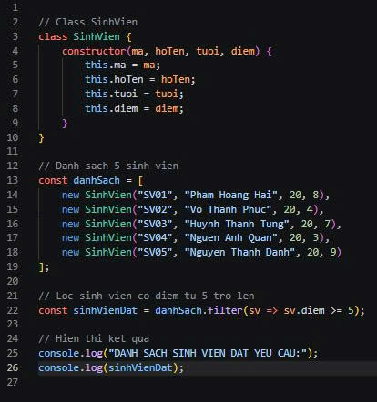
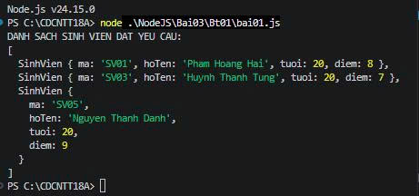

# BAI THUC HANH NODEJS - BAI 01

## 1. Mo ta

Tao danh sach 5 sinh vien su dung class va constructor.

Su dung arrow function de loc sinh vien co diem tu 5 tro len.

## 2. Cau truc du an

- bai01.js
- README.md
- code.png
- ketqua.png

## 3. Cach chay chuong trinh

B1: Mo VS Code.

B2: Mo Terminal.

B3: Di chuyen den thu muc Bt01.

B4: Chay lenh:

```bash
node bai01.js
```

## 4. Ket qua

Terminal hien thi danh sach sinh vien co diem tu 5 tro len.

## 5. Anh minh chung

### 5.1. Anh code chuong trinh



### 5.2. Anh ket qua chay chuong trinh


