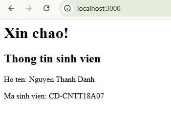

# BÀI TẬP 02 - NODE.JS HTTP SERVER

## 1. Giới thiệu
Tạo Web Server sử dụng module `http` của Node.js và chạy tại cổng 3000.

## 2. Nội dung thực hiện
- Tạo Web Server bằng module `http`.
- Truy cập `/`: Hiển thị lời chào và mã sinh viên.
- Truy cập `/about`: Hiển thị thông tin giới thiệu bản thân.
- Truy cập đường dẫn không tồn tại: Trả về HTTP 404.

## 3. Các lệnh thực hiện

**Bước 1:** Mở thư mục Bt02 bằng VS Code.

**Bước 2:** Tạo file `bai02.js` và nhập mã nguồn.

**Bước 3:** Mở Terminal và chạy lệnh:

```bash
node bai02.js
```

**Bước 4:** Mở trình duyệt và kiểm tra:

- http://localhost:3000
- http://localhost:3000/about
- http://localhost:3000/abc

## 4. Hình ảnh thực hiện

### Ảnh 1: Mã nguồn bai02.js


### Ảnh 2: Chạy Server


### Ảnh 3: Kết quả trang chủ


### Ảnh 4: Kết quả trang giới thiệu


### Ảnh 5: Kết quả lỗi 404


## 5. Kết luận
Đã hoàn thành chương trình Web Server bằng Node.js sử dụng module HTTP, chạy tại cổng 3000 và kiểm tra thành công các đường dẫn theo yêu cầu bài tập.