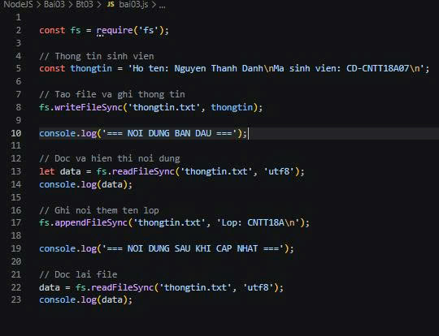
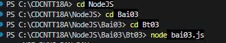
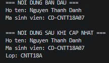
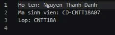

# BÀI TẬP 03 - NODE.JS FILE SYSTEM (FS)

## 1. Giới thiệu
Sử dụng module `fs` trong Node.js để tạo, đọc và cập nhật tập tin.

## 2. Yêu cầu
- Tạo tập tin `thongtin.txt` chứa họ tên và mã sinh viên.
- Đọc và hiển thị nội dung tập tin lên Terminal.
- Sử dụng `appendFile()` để ghi nối thêm tên lớp.
- Đọc lại tập tin để kiểm tra nội dung sau cập nhật.

## 3. Các bước thực hiện

**Bước 1:** Tạo tập tin `bai03.js`.

**Bước 2:** Sử dụng module `fs` để tạo và ghi thông tin sinh viên vào `thongtin.txt`.

**Bước 3:** Đọc tập tin và hiển thị nội dung lên Terminal.

**Bước 4:** Sử dụng `appendFileSync()` để ghi nối thêm tên lớp.

**Bước 5:** Đọc lại tập tin để kiểm tra nội dung đã cập nhật.

## 4. Lệnh chạy chương trình

```bash
node bai03.js
```

## 5. Hình ảnh thực hiện

### Ảnh 1: Mã nguồn bai03.js


### Ảnh 2: Chạy chương trình


### Ảnh 3: Nội dung Terminal sau cập nhật


### Ảnh 4: Nội dung file thongtin.txt


## 6. Kết luận
Đã hoàn thành chương trình Node.js sử dụng module fs để tạo tập tin, đọc nội dung và ghi nối thêm thông tin lớp bằng appendFileSync().
