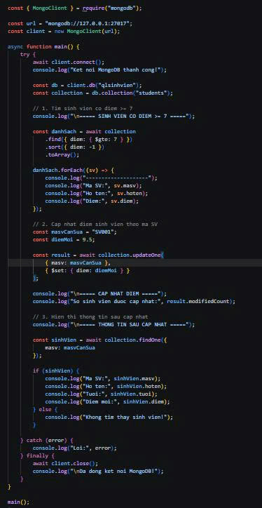
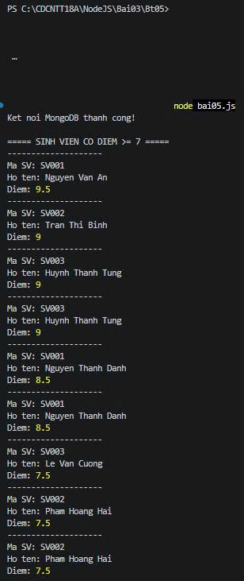
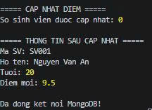

# BÀI TẬP 05 – MONGODB

## 1. Nội dung
- Tìm sinh viên có điểm >= 7 bằng find() và $gte.
- Sắp xếp điểm giảm dần bằng sort().
- Cập nhật điểm bằng updateOne() và $set.
- Hiển thị thông tin sau cập nhật.

## 2. Lệnh thực hiện

```bash
node bai05.js
```

## 3. Kết quả
Chương trình thực hiện tìm kiếm, sắp xếp và cập nhật điểm sinh viên trong MongoDB.

## 4. Hình ảnh minh chứng

### Hình 1: Code chương trình


### Hình 2: Kết quả chạy


### Hình 3: Thông tin sau cập nhật
