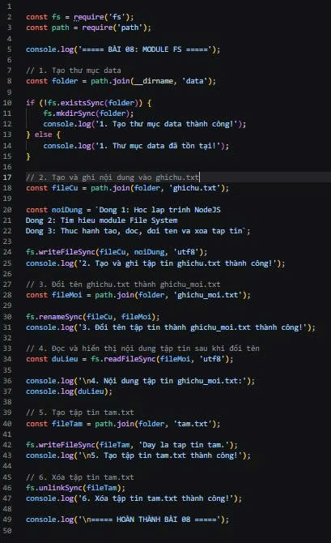
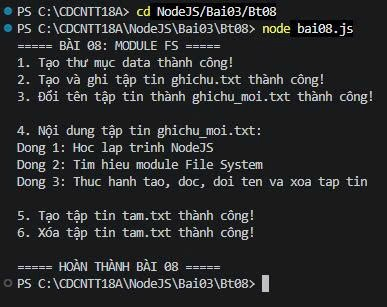
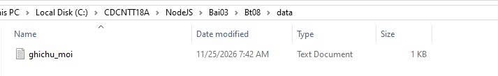

BÀI 08 – MODULE, FILE SYSTEM VÀ CƠ SỞ DỮ LIỆU
1. Giới thiệu

Bài thực hành sử dụng module fs trong Node.js để thực hiện các thao tác với thư mục và tập tin.

2. Công nghệ sử dụng
Node.js
Module fs
Module path
Visual Studio Code
3. Các chức năng thực hiện
Tạo thư mục data.
Tạo tập tin ghichu.txt.
Ghi ít nhất 3 dòng nội dung vào tập tin.
Đổi tên ghichu.txt thành ghichu_moi.txt bằng fs.renameSync().
Đọc và hiển thị nội dung tập tin mới.
Tạo tập tin tam.txt.
Xóa tập tin tam.txt bằng fs.unlinkSync().
4. Lệnh thực hiện

Chạy chương trình bằng lệnh:

bash
node bai08.js

5. Hình ảnh minh họa
Hình 1: Mã nguồn bai08.js

Hình 2: Kết quả chạy chương trình

Hình 3: Kết quả thư mục data

T
6. Kết quả

Chương trình thực hiện thành công các thao tác tạo thư mục, tạo tập tin, ghi nội dung, đổi tên, đọc nội dung và xóa tập tin bằng module fs của Node.js.
